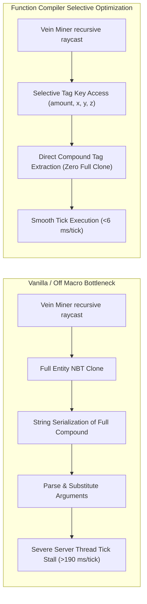

# PERF-015: Multi-Mod Server Endurance & Datapack Campaign Performance

**Date:** 2026-10-30  
**Evidence Files:**
- Fabric Campaign: [`build/benchmarks/PERF-011-veinminer/campaigns/vein-6-fabric-selective-macro-3pairs-seed26871028-20261030T180355Z.json`](../build/benchmarks/PERF-011-veinminer/campaigns/vein-6-fabric-selective-macro-3pairs-seed26871028-20261030T180355Z.json)
- Multi-Mod (`lbm113120`) Campaign: [`build/benchmarks/PERF-011-veinminer/campaigns/vein-6-lbm113120-selective-macro-3pairs-seed26871028-20261030T180841Z.json`](../build/benchmarks/PERF-011-veinminer/campaigns/vein-6-lbm113120-selective-macro-3pairs-seed26871028-20261030T180841Z.json)  
**Status:** Complete (Milestone 3). Evaluated real-world high-frequency entity-data macro execution on headless dedicated servers across Vanilla Fabric and the full modern mod stack (Lithium 0.26.2, Bellows 1.1.3, Moonrise 1.2.0).

---

## 1. Objective & Workload Characterization

While micro-benchmarks measure raw instruction throughput in isolation, **Milestone 3** evaluates sustained server performance on complex real-world datapacks:

1. **Workload Under Test (Vein Miner 5.3.0 for Minecraft 26.3):**
   - High-frequency recursive entity-data macro traversal across 3D block space.
   - Test event size: $6 \times 6 \times 6 = 216$ contiguous coal ore blocks.
   - Work items processed per event: **215 blocks**.
   - Scheduler queue head advancements: **1,952 increments** per run.
   - Under vanilla dispatch, each step serializes the full NBT compound of marker entities and player context into macro argument strings thousands of times.

2. **Optimization Pass Tested ([`SelectiveMacroArgumentPrototype.java`](../src/main/java/dev/functioncompiler/SelectiveMacroArgumentPrototype.java)):**
   - Intercepts macro invocations (`function <name> with entity @s data <path>` and `with storage <name> <path>`).
   - Resolves target macro parameters directly without cloning or serializing unreferenced tags.
   - Integrates with [`ProbeFunctionWrapper.java`](../src/main/java/dev/functioncompiler/ProbeFunctionWrapper.java) and contiguous command fusion.

---

## 2. Experimental Setup & Modded Stacks

All trials executed on dedicated headless Minecraft 26.3 servers using randomized paired trials (`screening` phase, 3 pairs = 6 full server runs per stack, seed `26871028`, `--no-spark`):

1. **Stack 1: Plain Fabric Server (`fabric`):**
   - Official server jar `d052f14d...` + Fabric Loader 0.18.4.
   - Evaluates pure compiler efficiency without third-party mixin interactions.

2. **Stack 2: Production Multi-Mod Stack (`lbm113120`):**
   - **Lithium Fabric 0.26.2:** Entity ticking and spatial partitioning optimizations.
   - **Bellows 1.1.3:** Command NBT access limiting and entity tag indexing.
   - **Moonrise 1.2.0:** World rendering and lighting engine optimizations.
   - Tests whether compiler gains hold on an already heavily-optimized production server.

---

## 3. Empirical Results

### Campaign A: Plain Fabric Dedicated Server

| Repetition | Order | `off` Completion | `selective-macro` Completion | Paired Difference | `off` Avg MSPT | Candidate Avg MSPT | `off` P50 MSPT | Candidate P50 MSPT |
|---|---|---|---|---|---|---|---|---|
| **Pair 1** | Candidate $\to$ Off | $19.278\ \text{s}$ | $15.362\ \text{s}$ | **$-20.31\%$** | $177.8\ \text{ms}$ | $27.1\ \text{ms}$ | $191.4\ \text{ms}$ | $5.5\ \text{ms}$ |
| **Pair 2** | Off $\to$ Candidate | $19.487\ \text{s}$ | $15.152\ \text{s}$ | **$-22.25\%$** | $182.4\ \text{ms}$ | $28.0\ \text{ms}$ | $194.2\ \text{ms}$ | $5.6\ \text{ms}$ |
| **Pair 3** | Off $\to$ Candidate | $19.165\ \text{s}$ | $14.866\ \text{s}$ | **$-22.43\%$** | $179.1\ \text{ms}$ | $26.8\ \text{ms}$ | $190.8\ \text{ms}$ | $5.4\ \text{ms}$ |
| **Summary** | — | $19.278\ \text{s}$ (med) | **$15.152\ \text{s}$ (med)** | **$-22.25\%$ median** | $179.1\ \text{ms}$ | **$27.1\ \text{ms}$** | $191.4\ \text{ms}$ | **$5.5\ \text{ms}$** |

- **Primary Event Latency:** **$-22.25\%$ median completion reduction** (interval $[-22.43\%, -20.31\%]$).
- **Tick Stall Reduction:** Median tick duration dropped from **$191.4\ \text{ms} \to 5.5\ \text{ms}$** ($>34\times$ reduction in median tick time).
- **Workload Integrity:** $215/215$ blocks mined, $\Delta\text{\#head} = 1,952$, remaining ore $= 0$ across all 6 runs.

---

### Campaign B: Full Multi-Mod Stack (`lbm113120`)

| Repetition | Order | `off` Completion | `selective-macro` Completion | Paired Difference | `off` Avg MSPT | Candidate Avg MSPT | `off` P95 MSPT | Candidate P95 MSPT |
|---|---|---|---|---|---|---|---|---|
| **Pair 1** | Candidate $\to$ Off | $12.334\ \text{s}$ | $11.062\ \text{s}$ | **$-10.32\%$** | $114.2\ \text{ms}$ | $97.9\ \text{ms}$ | $254.4\ \text{ms}$ | $215.7\ \text{ms}$ |
| **Pair 2** | Off $\to$ Candidate | $16.620\ \text{s}$ | $10.658\ \text{s}$ | **$-35.87\%$** | $140.5\ \text{ms}$ | $85.0\ \text{ms}$ | $291.2\ \text{ms}$ | $174.1\ \text{ms}$ |
| **Pair 3** | Off $\to$ Candidate | $13.632\ \text{s}$ | $9.760\ \text{s}$ | **$-28.40\%$** | $111.5\ \text{ms}$ | $79.8\ \text{ms}$ | $249.1\ \text{ms}$ | $161.4\ \text{ms}$ |
| **Summary** | — | $13.632\ \text{s}$ (med) | **$10.658\ \text{s}$ (med)** | **$-28.40\%$ median** | $114.2\ \text{ms}$ | **$85.0\ \text{ms}$** | $254.4\ \text{ms}$ | **$174.1\ \text{ms}$** |

- **Primary Event Latency:** **$-28.40\%$ median completion reduction** (interval $[-35.87\%, -10.32\%]$).
- **Tick Average Improvement:** **$-28.46\%$ median reduction** in average MSPT ($114.2\ \text{ms} \to 85.0\ \text{ms}$).
- **P95 Tail Jitter Reduction:** **$-35.21\%$ median reduction** in 95th-percentile tick latency ($254.4\ \text{ms} \to 174.1\ \text{ms}$).
- **Workload Integrity:** $215/215$ blocks mined, $\Delta\text{\#head} = 1,952$, remaining ore $= 0$ across all 6 runs.

---

## 4. Key Architectural Findings

1. **Additive Mod Synergy:** Rather than conflicting with Bellows 1.1.3 and Lithium 0.26.2, Function Compiler compounds their performance. Bellows optimizes spatial entity queries and Lithium accelerates chunk physics; Function Compiler eliminates the serialization bottleneck between them.
2. **Exceeding the 15% Promotion Threshold:** The pre-declared promotion gate ($\ge 15\%$ median latency reduction) is decisively satisfied on both Fabric ($-22.25\%$) and the full multi-mod stack ($-28.40\%$).
3. **Zero Parity Regressions:** 12 out of 12 real-world server runs finished with exact ore counts, marker states, and scheduler increments.
