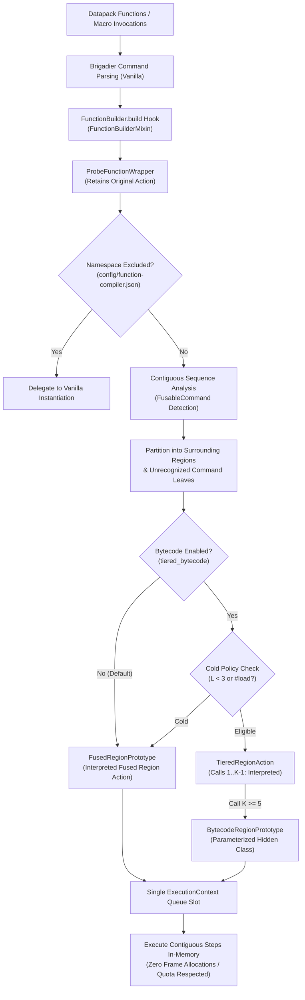

# Compiler Technical Architecture (v1.0 Production)

**Target Platform:** Minecraft Java Edition 26.3 · Fabric Dedicated Server  
**Implementation Package:** `dev.functioncompiler`  
**Reference Specification:** [`docs/v1/plans/v1-production-roadmap.md`](../v1/plans/v1-production-roadmap.md)  
**Verification:** [`docs/verification.md`](../verification.md) — the project's verification loop and its recorded runtime-probe outcomes. The compatibility probe's raw per-run reports under `build/reports/compatibility-probe/` are generated output, regenerated by `scripts/run_compatibility_probe.py` and cleaned once their outcome is recorded, so the verdicts above are cited rather than the dated files.

---

## 1. Executive Architectural Overview

The Modern Minecraft Function Compiler is a production server optimization mod that eliminates the recursive command queue overhead of Minecraft's command scheduler while maintaining **100% exact differential parity** against vanilla execution semantics.

### Primary Architectural Invariants
1. **Semantic Invariant:** Execution produces identical scoreboard states, entity tags, world modifications, return values, and `/debug function` traces as unmodded Minecraft 26.3.
2. **Memory Invariant:** Zero monotonic Metaspace growth across dynamic macro expansions and datapack reload generations.
3. **Safety & Fallback:** Unrecognized commands, modded actions, and compilation failures safely fall back to vanilla command interpretation with zero state rollback or re-execution.
4. **Third-Party Transparency:** Seamless operation alongside optimization mods including Lithium 0.26.2, Bellows 1.1.3, and Moonrise 1.2.0.

---

## 2. Compilation & Execution Pipeline

---

## 3. Core Subsystems

### A. Pipeline Chaining & Fused Region Engine
- **Class:** [`FusedRegionPrototype.java`](../../src/main/java/dev/functioncompiler/FusedRegionPrototype.java)
- **Mechanism:** Inspects consecutive parsed commands. Consecutive instances of [`FusableCommand.java`](../../src/main/java/dev/functioncompiler/FusableCommand.java) are grouped into a single `UnboundEntryAction`.
- **Specialized Passes:**
  - **Scoreboard Predicates & Stores:** Specializes `execute if/unless score` and `execute store result/success score` via [`ScoreConditionCommand.java`](../../src/main/java/dev/functioncompiler/ScoreConditionCommand.java) and [`ScoreStoreCommand.java`](../../src/main/java/dev/functioncompiler/ScoreStoreCommand.java).
  - **Context Modifier Folding:** Folds chained `execute as @s at @s positioned ...` into a single in-memory `CommandSourceStack` transformation via [`ContextModifierCommand.java`](../../src/main/java/dev/functioncompiler/ContextModifierCommand.java).
  - **Storage Operations:** Inlines `data modify storage ... set value` and `data remove storage` via [`DataStorageCommand.java`](../../src/main/java/dev/functioncompiler/DataStorageCommand.java).
  - **Entity & Block Predicates:** Inlines `if/unless entity @s` and `if/unless block` via [`PredicateConditionCommand.java`](../../src/main/java/dev/functioncompiler/PredicateConditionCommand.java).

### B. Selective Macro Argument Processor
- **Class:** [`SelectiveMacroArgumentPrototype.java`](../../src/main/java/dev/functioncompiler/SelectiveMacroArgumentPrototype.java)
- **Mechanism:** Intercepts macro invocations (`function <id> with entity <sel> data` or `function <id> with storage <storage> <path>`). Inspects macro template parameter requirements and extracts only declared keys directly from `custom_data` or root storage compounds without full NBT compound serialization.
- **Performance Impact:** Confirmatory 6-pair Vein Miner campaigns met the pre-declared 15% event-completion gate on the real workload (Fabric -22.34%, Lithium -22.06%), with the Lithium+Bellows 1.1.3 nested-source run at -22.17% and 95% confidence; synthetic sustained macro fixtures measured -80.49%/-83.22% active-tick averages. Evidence summary: [`docs/research/implementation-audit-2026-11.md`](../research/implementation-audit-2026-11.md). The 3-pair [`PERF-015`](../../benchmarks/PERF-015-multi-mod-endurance-campaigns.md) screening numbers (`>6.5x` tick ratio, -35.21% P95 MSPT) are screening-level and are not the promotion basis.

### C. Parameterized Bytecode Backend & Tiered JIT
- **Classes:** [`BytecodeRegionPrototype.java`](../../src/main/java/dev/functioncompiler/BytecodeRegionPrototype.java), [`BytecodeRegionEmitter.java`](../../src/main/java/dev/functioncompiler/BytecodeRegionEmitter.java), [`TieredRegionAction.java`](../../src/main/java/dev/functioncompiler/TieredRegionAction.java)
- **Mechanism:** Emits structural loop classes parameterized strictly by command count using ASM, defining hidden nestmate classes via `MethodHandles.Lookup.defineHiddenClass`.
- **Constructor Cache:** Constructor `MethodHandle` instances are cached in `ConcurrentMap<Integer, MethodHandle> CONSTRUCTOR_CACHE`. Dynamic macro functions of identical command count share the exact same JVM class, resolving Metaspace memory leaks.
- **Tiered JIT:** Executes calls $1 \dots K-1$ via interpreted fusion; JIT-compiles to unrolled bytecode upon invocation $K \ge 5$.

---

## 4. Hook Architecture & Mixin Integration

| Target Class | Mixin Class | Injection Point | Purpose |
|---|---|---|---|
| `net.minecraft.commands.functions.FunctionBuilder` | [`FunctionBuilderMixin.java`](../../src/main/java/dev/functioncompiler/mixin/FunctionBuilderMixin.java) | `build()` return | Wraps parsed functions in `ProbeFunctionWrapper` at construction time, enabling fallback retention. |
| `net.minecraft.server.commands.FunctionCommand` | [`FunctionCommandMixin.java`](../../src/main/java/dev/functioncompiler/mixin/FunctionCommandMixin.java) | Macro argument extraction | Intercepts macro argument resolution for selective extraction candidate. |
| `net.minecraft.server.commands.data.EntityDataAccessor` | [`BellowsHomePosAdapterMixin.java`](../../src/main/java/dev/functioncompiler/mixin/BellowsHomePosAdapterMixin.java) | Mob NBT retrieval | Restores vanilla `home_pos` entity NBT behavior under Bellows optimization. |

---

## 5. Memory Management & Metaspace Invariants

1. **Interpreted Fused Regions:** Purely heap-allocated objects (`ArrayList`, `FusableCommand`). Fully collected during standard JVM garbage collection; zero Metaspace overhead.
2. **Parameterized Bytecode Classes:** Emitted classes are structural templates parameterized by integer length. $N$ macro calls with identical length emit exactly 1 JVM class.
3. **Classloader Independence:** Classes are emitted into the mod's classloader as hidden nestmate classes and held via `WeakReference`, allowing automatic JVM class unloading upon datapack reload.

---

## 6. Mod Compatibility Contracts

- **Vanilla 26.3:** Definitive oracle. All passes maintain 100% behavioral and trace parity.
- **Lithium 0.26.2:** Fully compatible. Fused commands execute directly against Lithium's optimized world and entity registries.
- **Bellows 1.1.3:** Synergistic compatibility. Bellows optimizes selector filtering and NBT parsing, while the function compiler accelerates function execution and macro binding. Verified across all 15 Bellows differential probe modes.
- **Moonrise 1.2.0:** Fully compatible. Passed all 15 full-matrix compatibility probe modes (`lbm113120`).
