# Coverage Expansion Spec: Multi-Entity Selector Inlined Forking

**Status:** Proposed Architecture & Verification Plan  
**Target Platform:** Minecraft Java Edition 26.3 · Fabric Dedicated Server  
**Parent Roadmap:** [`v1-production-roadmap.md`](v1-production-roadmap.md)  
**Verification Target:** 100% Observable Parity with Vanilla `runCommandQueue` Forking

---

## 1. Problem Statement & Performance Motivation

In Minecraft Java Edition, datapacks frequently execute commands across multiple entities:
```mcfunction
execute as @e[type=zombie,distance=..32] run scoreboard players add @s tick_timer 1
```

### The Vanilla Bottleneck: Severe Queue Churn
In vanilla Minecraft 26.3 (`BuildContexts.java`):
1. The selector resolves $N$ matching entities (e.g., 50 entities).
2. For each entity, vanilla creates a new `CommandSourceStack` with that entity as the executor.
3. Vanilla calls `ContinuationTask.schedule()`, pushing $N$ separate `ExecuteCommand` entries into `ExecutionContext.commandQueue`.
4. In the scheduler tick loop, `runCommandQueue()` pops each entry individually, debits quota, updates frame depths, and executes each entry as a distinct scheduler step.

When a datapack runs multi-entity selector loops each tick, this mechanism creates tens of thousands of queue allocations and context-switching steps per second, dominating the server's main thread tick time.

---

## 2. Inlined Forking Architecture

Rather than enqueuing $N$ independent frames onto the scheduler queue, **Inlined Forking** evaluates the iteration within a single execution frame when the inner command is specialized or fusable:

```mermaid
flowchart TD
    subgraph Vanilla["Vanilla 26.3 Dispatch"]
        V_Sel["execute as @e[type=zombie] run ..."] --> V_Resolve["EntitySelector resolves N entities"]
        V_Resolve --> V_Fork["Enqueues N ExecuteCommand frames"]
        V_Fork --> V_Queue["ExecutionContext.commandQueue (N entries)"]
        V_Queue --> V_Loop["Scheduler pops & debits quota N times<br/>(Heavy trampoline churn)"]
    end

    subgraph Inlined["Function Compiler Inlined Forking"]
        I_Sel["execute as @e[type=zombie] run ..."] --> I_Resolve["EntitySelector resolves N entities"]
        I_Resolve --> I_Inline["Internal Java Loop: for (Entity e : entities)"]
        I_Inline --> I_Quota["Check & debit ExecutionContext quota per entity"]
        I_Quota --> I_Exec["Direct innerCommand.run(context.copyFor(source.withEntity(e)))"]
        I_Exec --> I_Single["1 Single Scheduler Step (-98% Queue Churn)"]
    end
```



### 2.1 Core Invariant Guarantees
To maintain 100% observable parity with vanilla Minecraft 26.3:

1. **Fork Limit Semantics (`forkLimit`):**
   - Vanilla enforces `ExecutionContext.forkLimit()` (governed by server configuration / gamerules).
   - If `entities.size() > context.forkLimit()`, Inlined Forking must throw `BuildContexts.ERROR_FORK_LIMIT_REACHED.create(forkLimit)` without executing any entities.
2. **Quota Stopping Boundary:**
   - In vanilla, each executed entity debits `commandQuota` by 1 via `context.incrementCost()`.
   - If `commandQuota <= 0` at entity index $K < N$, execution halts immediately.
   - Inlined Forking accesses the active `ExecutionContext` via `ExecutionContextMixin.currentContext()`, evaluates `accessor.functionCompiler$getCommandQuota() <= 0` prior to each entity, debits quota, and breaks out cleanly when depleted.
3. **Empty Entity Match (Zero Matches):**
   - If 0 entities match the selector, the inlined loop executes 0 times and returns 0 with zero NPE or state changes.
4. **Result Summation:**
   - The return value of `InlinedForkingCommand` is the sum of the results returned by each entity execution (matching `ContextChain.executeAll`).
   - Downstream `execute store result score ...` receives the exact total matching vanilla.
5. **Downstream Context Modifier Composition:**
   - When chained with context modifiers (e.g. `execute as @e[...] at @s positioned ~ ~1 ~ run ...`), the downstream transformations are applied to `source.withEntity(entity)` per entity in the loop.

---

## 3. Implementation Design

### 3.1 Components

1. **`InlinedForkingCommand.java`:**
   - Implements `FusableCommand`.
   - Fields:
     - `EntitySelector selector`
     - `List<ContextModifierCommand.Transformation> downstreamTransformations`
     - `Command<CommandSourceStack> innerCommand`
     - `ContextChain<CommandSourceStack> fallbackChain`
     - `Identifier functionId`
   - Execution Logic:
     ```java
     List<? extends Entity> entities = selector.findEntities(source);
     if (entities.isEmpty()) {
         return 0;
     }
     ExecutionContext<CommandSourceStack> execContext = ExecutionContextMixin.currentContext();
     if (execContext != null && entities.size() > execContext.forkLimit()) {
         throw BuildContexts.ERROR_FORK_LIMIT_REACHED.create(execContext.forkLimit());
     }
     int total = 0;
     for (Entity entity : entities) {
         if (execContext != null) {
             ExecutionContextAccessor<CommandSourceStack> acc = (ExecutionContextAccessor<CommandSourceStack>) (Object) execContext;
             if (acc.functionCompiler$getCommandQuota() <= 0) {
                 break;
             }
             execContext.incrementCost();
         }
         CommandSourceStack entitySource = source.withEntity(entity);
         for (ContextModifierCommand.Transformation t : downstreamTransformations) {
             entitySource = t.apply(context, entitySource);
             if (entitySource == null) break;
         }
         if (entitySource != null) {
             total += innerCommand.run(context.copyFor(entitySource));
         }
     }
     return total;
     ```

2. **`ExecutionContextMixin.java` Update:**
   - Maintain a thread-local reference to the currently executing `ExecutionContext` during `runCommandQueue()`:
     ```java
     private static final ThreadLocal<ExecutionContext<?>> CURRENT_CONTEXT = new ThreadLocal<>();
     
     public static <T> ExecutionContext<T> currentContext() {
         return (ExecutionContext<T>) CURRENT_CONTEXT.get();
     }
     ```

3. **`ScoreAddPrototype.java` Update:**
   - Extend `parseModifiers` to recognize `as <targets>` with non-`@s` `EntitySelector`.
   - When a selector fork is detected, wrap the executable in `InlinedForkingCommand` and collapse the modifier chain.

---

## 4. Verification & Test Strategy

1. **Correctness & Parity Checks:**
   - Differential comparison against vanilla 26.3 with 0, 1, 5, and 50 matching entities.
   - Verification of `execute store result` capturing exact entity counts.
2. **Quota Exhaustion Boundary:**
   - Sweeping `gamerule minecraft:max_command_sequence_length` with 10 entities under limits 0, 1, 3, 5, 8, 12. Must halt at exact entity counts matching vanilla.
3. **Multi-Mod Synergy:**
   - Verified alongside Lithium spatial queries, Bellows type caches, FerriteCore NBT deduplication, and C2ME async chunk management.
