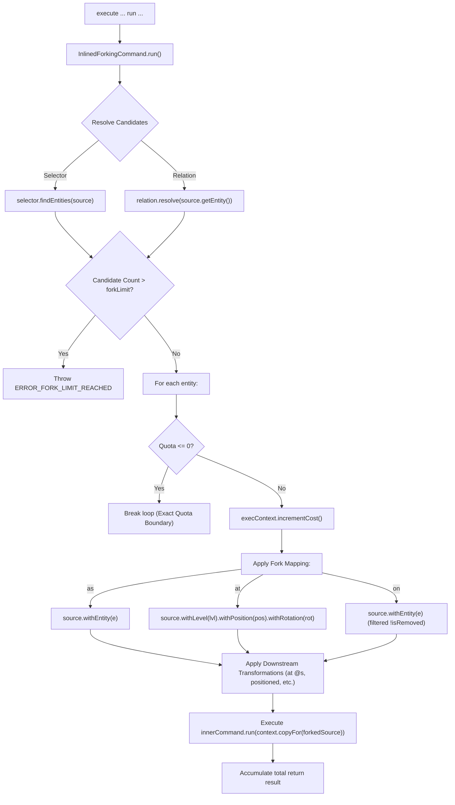

# Track A Specification: Selector Forking & Entity Relational Traversal

**Status:** Implementation & Verification Plan  
**Target Platform:** Minecraft Java Edition 26.3 · Fabric Dedicated Server (`net.fabricmc.fabric-loader:0.20.1`)  
**Parent Roadmap:** [`docs/v1/plans/v1-production-roadmap.md`](v1-production-roadmap.md)  
**Verification Target:** 100% Differential Parity with Vanilla 26.3 `runCommandQueue`

---

## 1. Problem Statement & Motivation

In Minecraft 26.3 datapacks, entity iteration and relationship queries are among the most frequent command operations:
```mcfunction
# Spatial iteration across entities:
execute at @e[type=item,distance=..16] run particle flame ~ ~ ~ 0.1 0.1 0.1 0.05 10

# Combined identity switch and spatial positioning:
execute as @e[type=zombie] at @s run scoreboard players add @s tick 1

# Entity relational traversal (1.20.2+ / 26.3 execute on):
execute as @e[type=horse] on controller run scoreboard players add @s mounted_ticks 1
```

### The Vanilla Bottleneck
In vanilla Minecraft 26.3 (`ExecuteCommand.java`, `BuildContexts.java`):
1. `execute as <selector>`, `execute at <selector>`, and `execute on <relation>` call Brigadier's `.fork(...)`.
2. Vanilla resolves the candidate entities (via `EntitySelector.findEntities` or relation lambdas).
3. Vanilla calls `ContinuationTask.schedule()`, pushing $N$ separate `ExecuteCommand` tasks onto the server's `ExecutionContext.commandQueue`.
4. In the main server loop, `runCommandQueue()` pops each entry individually, debits quota, allocates sub-frames, and processes each entity as a separate scheduler step.

On servers with 50–200 active entities, this creates tens of thousands of queue allocations and context switches per second.

---

## 2. Architecture & Design

Track A extends [`InlinedForkingCommand.java`](../../../src/main/java/dev/functioncompiler/InlinedForkingCommand.java) into a unified, high-performance inlined entity iterator:



### 2.1 Invariant Guarantees (100% Vanilla Parity)
1. **Fork Limit Check:** If candidate count exceeds `execContext.forkLimit()`, throw `BuildContexts.ERROR_FORK_LIMIT_REACHED.create(forkLimit)` immediately before executing any entity.
2. **Quota Debit Invariant ($1 + N$):** Scheduler debits 1 on queue pop; each entity loop checks `commandQuota <= 0` and calls `execContext.incrementCost()`. Stopping points across sweeps 0, 1, 2, 3, 4, 5, 8 must match vanilla byte-for-byte.
3. **Context State Integrity:**
   - `execute as <targets>`: Replaces `source.getEntity()`; coordinates remain unchanged.
   - `execute at <targets>`: Replaces `level`, `position`, and `rotation` to match the target entity; `source.getEntity()` remains unchanged.
   - `execute on <relation>`: Replaces `source.getEntity()` with the related entity; coordinates remain unchanged. If `source.getEntity() == null` or relation is empty, executes 0 times. Removed entities (`entity.isRemoved()`) are discarded.
4. **Composition with Downstream Modifiers:**
   - `execute as @e[...] at @s ...`: `as` sets the executor, and subsequent `at @s` updates coordinates to that executor.

---

## 3. Implementation Steps

1. **Refactor `InlinedForkingCommand.java`:**
   - Define `ForkSource` interface:
     - `SelectorSource(EntitySelector selector)`
     - `RelationSource(EntityRelation relation)`
   - Define `ForkTransformer` functional interface:
     - `AS`: `(src, e) -> src.withEntity(e)`
     - `AT`: `(src, e) -> src.withLevel((ServerLevel) e.level()).withPosition(e.position()).withRotation(e.getRotationVector())`
   - Implement `EntityRelation` enum covering all 8 vanilla 26.3 relations:
     - `OWNER`: `OwnableEntity.getOwner()`
     - `LEASHER`: `Leashable.getLeashHolder()`
     - `TARGET`: `Targeting.getTarget()`
     - `ATTACKER`: `Attackable.getLastAttacker()`
     - `VEHICLE`: `Entity.getVehicle()`
     - `CONTROLLER`: `Entity.getControllingPassenger()`
     - `ORIGIN`: `TraceableEntity.getOwner()`
     - `PASSENGERS`: `Entity.getPassengers()`
2. **Update Grammar Parsing in `InlinedForkingCommand.java`:**
   - Add `parseAtForkModifier`: matches `execute at <targets>` when targets != `@s`.
   - Add `parseOnModifier`: matches `execute on <relation>`.
3. **Create Automated Differential Probe Fixture:**
   - Datapack functions testing:
     - `execute at @e[...] run scoreboard players add #accum obj 10`
     - `execute as @e[...] at @s run ...`
     - `execute on vehicle run ...` / `execute on passengers run ...`
   - Test harness running across `vanilla`, `fabric-on`, and `bytecode-emitted`.
4. **Run Verification & Hygiene:**
   - Confirm 100% parity across all test vectors.
   - Verify EA findings remain $\le 94$ (baseline 93).
