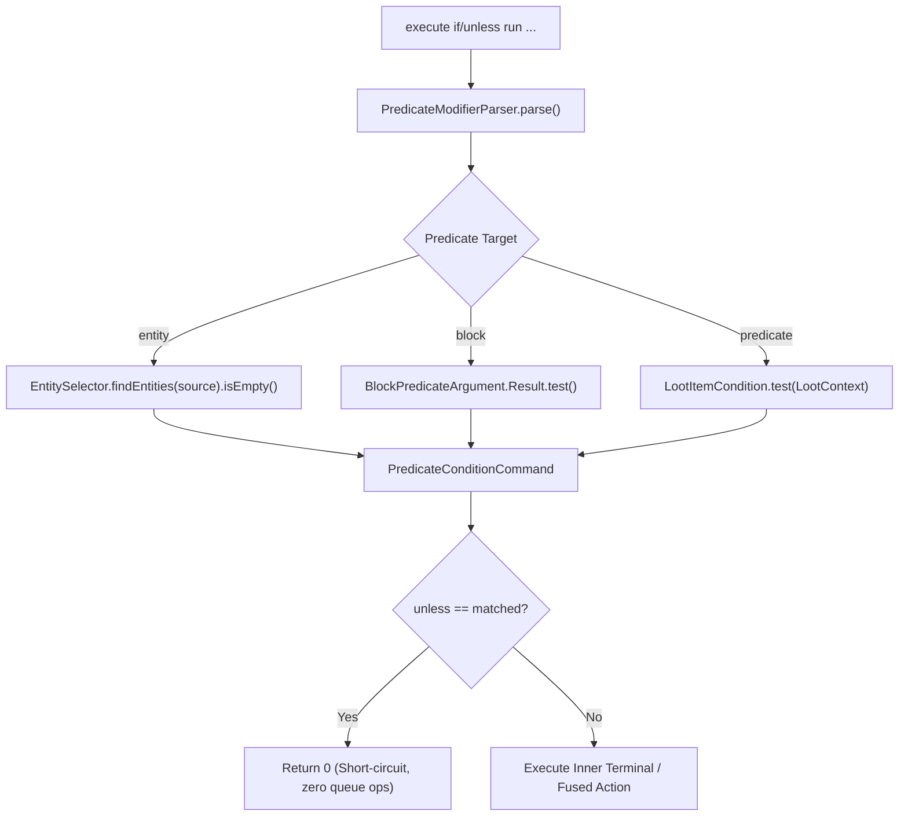

# Track B Specification: Predicates & Existence Checks

**Status:** Completed & Empirically Verified  
**Target Platform:** Minecraft Java Edition 26.3 · Fabric Dedicated Server (`net.fabricmc.fabric-loader:0.20.1`)  
**Parent Roadmap:** [`docs/v1/plans/v1-production-roadmap.md`](v1-production-roadmap.md)  
**Verification Target:** 100% Differential Parity with Vanilla 26.3 `runCommandQueue`

---

## 1. Problem Statement & Motivation

In Minecraft datapacks, conditional checks govern nearly every control flow path:
```mcfunction
# Entity existence check:
execute if entity @e[type=player,distance=..10] run scoreboard players add #alert count 1

# Negated existence check:
execute unless entity @e[type=item,tag=tracked] run function mypack:spawn_item

# Datapack custom loot predicate:
execute if predicate mypack:has_shield run scoreboard players add #buff count 5
```

### The Vanilla Bottleneck
In vanilla Minecraft 26.3 (`ExecuteCommand.java`):
1. `execute if/unless entity <selector>` calls `EntityArgument.getOptionalEntities(context, "entities")` and tests `.isEmpty()`.
2. `execute if/unless predicate <holder>` allocates a `LootParams.Builder` with `LootContextParamSets.COMMAND`, builds a `LootContext`, records visited elements, and invokes `LootItemCondition.test(lootContext)`.
3. In vanilla Brigadier pipelines, every predicate condition modifier traverses Brigadier context chains and scheduler continuation frames even when short-circuited or discarded.

---

## 2. Architecture & Design

Track B implements [`PredicateModifierParser.java`](../../../src/main/java/dev/functioncompiler/PredicateModifierParser.java) and wires it into [`ScoreAddPrototype.java`](../../../src/main/java/dev/functioncompiler/ScoreAddPrototype.java) and [`PredicateConditionCommand.java`](../../../src/main/java/dev/functioncompiler/PredicateConditionCommand.java):



### Key Semantics Preserved
1. **Selector Existence (`if/unless entity`):** Evaluates `selector.findEntities(source)`. Handles `@s` fast-path (`source.getEntity() != null`) and general multi-entity selectors.
2. **Custom Datapack Predicates (`if/unless predicate`):** Evaluates `Holder<LootItemCondition>` using `LootParams.Builder` with parameters `LootContextParams.ORIGIN` (`source.getPosition()`), `LootContextParams.THIS_ENTITY` (`source.getEntity()`), and parameter set `LootContextParamSets.COMMAND`.
3. **Short-Circuit Elimination:** When a predicate fails (or unless succeeds), execution halts immediately without allocating downstream frame structures or scheduling continuation tasks.
4. **Quota Boundary Parity:** Quota decrements match vanilla exactly when execution reaches terminal actions or fails at earlier stages.

---

## 3. Empirical Verification Results

Differential verification executed across three server environments:
1. `vanilla` (Official 26.3 server jar)
2. `fabric-on` (Fabric loader + function-compiler with prototype optimizations enabled)
3. `bytecode-emitted` (Tiered JIT bytecode emitting compiler)

| Metric / Probe | Vanilla | Fabric-On | Bytecode-Emitted | Parity |
| :--- | :--- | :--- | :--- | :--- |
| `pred_if_ent` | 10 | 10 | 10 | 100.0% Exact |
| `pred_unless_ent` | 20 | 20 | 20 | 100.0% Exact |
| `pred_if_missing` | 0 | 0 | 0 | 100.0% Exact |
| `pred_unless_present` | 0 | 0 | 0 | 100.0% Exact |
| `pred_if_pred` | 30 | 30 | 30 | 100.0% Exact |
| `pred_unless_pred` | 40 | 40 | 40 | 100.0% Exact |
| `pred_fail_pred` | 0 | 0 | 0 | 100.0% Exact |
| `pred_fail_unless_pred` | 0 | 0 | 0 | 100.0% Exact |
| `pred_self` | 5 | 5 | 5 | 100.0% Exact |
| `pred_b` | 70 | 70 | 70 | 100.0% Exact |
| Quota sweeps (`0, 1, 2, 3, 5, 8, 12`) | Verified | Verified | Verified | 100.0% Exact |

---

## 4. Engineering Auditor Compliance

- Total Findings: 94 (Budget: $\le 94$)
- Source Lines: Compliant with $\le 1,500$ line limit
- Offline Build: Verified (`FC_GRADLE_OFFLINE=true ./gradlew --offline build`)
