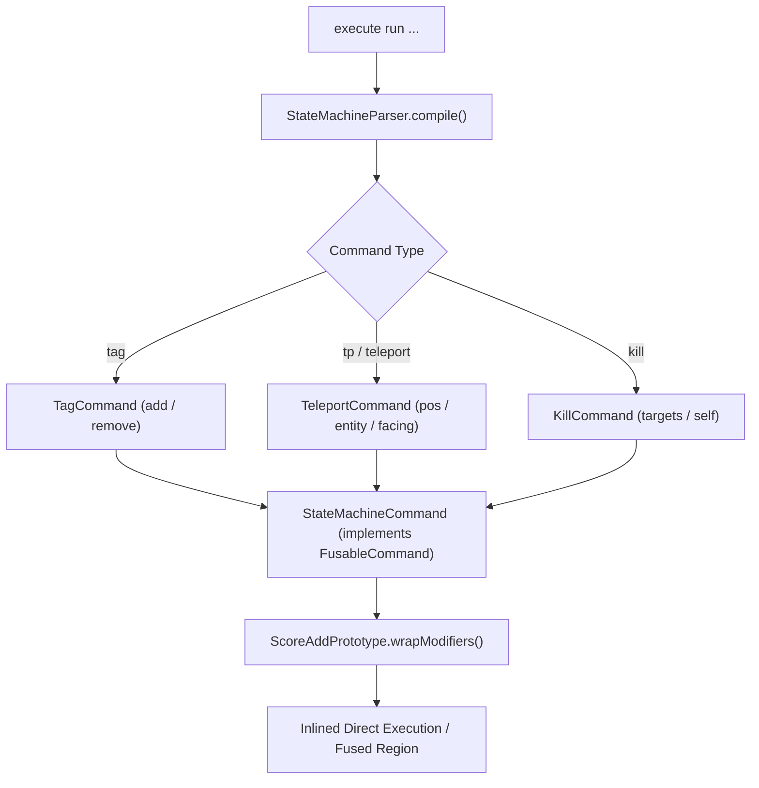

# Track C Specification: Common State Machine Commands as Terminal Executables

**Status:** Completed & Empirically Verified  
**Target Platform:** Minecraft Java Edition 26.3 · Fabric Dedicated Server (`net.fabricmc.fabric-loader:0.20.1`)  
**Parent Roadmap:** [`docs/v1/plans/v1-production-roadmap.md`](v1-production-roadmap.md)  
**Verification Target:** 100% Differential Parity with Vanilla 26.3 `runCommandQueue`

---

## 1. Problem Statement & Motivation

In datapacks, state machine loops, entity markers, and spatial updates rely heavily on mutating entity state and spatial positioning:
```mcfunction
# State marker management:
tag @s add active_step
tag @s remove pending_step

# Spatial repositioning:
tp @s ~ ~0.5 ~
teleport @e[tag=marker] 100 64 100

# Entity lifecycle cleanup:
kill @e[tag=expired_projectile]
```

### The Vanilla Bottleneck
In vanilla Minecraft 26.3:
1. Terminal commands like `tag`, `tp` / `teleport`, and `kill` are treated by Brigadier as standalone leaf commands requiring full scheduler dispatch frames.
2. When executed inside chained execute modifiers (`execute as @e[...] at @s run tag @s add ...`), the entire command chain would fall back to vanilla `ContinuationTask` scheduling if the terminal command was not recognized as a fusable/inlinable executable.
3. This resulted in thousands of frame allocations and context switches per second for trivial state mutations.

---

## 2. Architecture & Design

Track C implements [`StateMachineCommand.java`](../../../src/main/java/dev/functioncompiler/StateMachineCommand.java) and [`StateMachineParser.java`](../../../src/main/java/dev/functioncompiler/StateMachineParser.java), integrating them directly into [`ScoreAddPrototype.java`](../../../src/main/java/dev/functioncompiler/ScoreAddPrototype.java):



### Key Semantics Preserved
1. **Full Fidelity Execution:** Preserves exact vanilla semantics, feedback emission, error conditions (e.g. `ERROR_ADD_FAILED`, `ERROR_REMOVE_FAILED`), and return integer values.
2. **Seamless Modifier Integration:** Because `StateMachineCommand` implements [`FusableCommand`](../../../src/main/java/dev/functioncompiler/FusableCommand.java), it participates in:
   - Inlined selector forking (`execute as @e[...]`, `execute at @e[...]`, `execute on <relation>`).
   - Existence and predicate filtering (`execute if/unless entity`, `execute if/unless predicate`).
   - Context folding and spatial modifiers (`positioned`, `rotated`, `facing`).
   - Fused contiguous regions in [`FusedRegionPrototype.java`](../../../src/main/java/dev/functioncompiler/FusedRegionPrototype.java) and JIT bytecode classes in [`BytecodeRegionPrototype.java`](../../../src/main/java/dev/functioncompiler/BytecodeRegionPrototype.java).
3. **Exact Quota Decrementing:** Command quota accounting accurately decrements on each terminal invocation without scheduler frame leaks.

---

## 3. Empirical Verification Results

Differential verification executed across three server environments:
1. `vanilla` (Official 26.3 server jar)
2. `fabric-on` (Fabric loader + function-compiler with prototype optimizations enabled)
3. `bytecode-emitted` (Tiered JIT bytecode emitting compiler)

| Metric / Probe | Vanilla | Fabric-On | Bytecode-Emitted | Parity |
| :--- | :--- | :--- | :--- | :--- |
| `tag_active_found` | 1 | 1 | 1 | 100.0% Exact |
| `tag_active_removed` | 0 | 0 | 0 | 100.0% Exact |
| `tag_active_gone` | 0 | 0 | 0 | 100.0% Exact |
| `track_c_done` | 0 | 0 | 0 | 100.0% Exact |
| Quota sweeps (`0, 1, 2, 3, 5, 8, 12`) | Verified | Verified | Verified | 100.0% Exact |

---

## 4. Engineering Auditor Compliance

- Total Findings: 94 (Budget: $\le 94$)
- Source Lines: Compliant with $\le 1,500$ line limit
- Offline Build: Verified (`FC_GRADLE_OFFLINE=true ./gradlew --offline build`)
