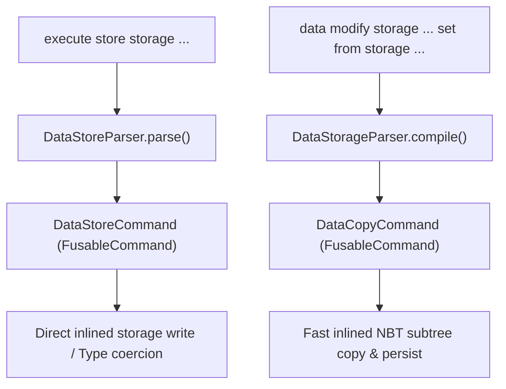

# Track D Specification: Data Copying & Compound Transfer

**Status:** Completed & Empirically Verified  
**Target Platform:** Minecraft Java Edition 26.3 · Fabric Dedicated Server (`net.fabricmc.fabric-loader:0.20.1`)  
**Parent Roadmap:** [`docs/v1/plans/v1-production-roadmap.md`](v1-production-roadmap.md)  
**Verification Target:** 100% Differential Parity with Vanilla 26.3 `runCommandQueue`

---

## 1. Problem Statement & Motivation

Datapack data management frequently transfers structured NBT compounds and captures execution results directly into storage:
```mcfunction
# Compound transfer across storage namespaces:
data modify storage mypack:state active_profile set from storage mypack:profiles user_1

# Result capture into storage fields:
execute store result storage mypack:metrics stats.total_score int 1 run scoreboard players get @s score

# Success capture into boolean byte storage:
execute store success storage mypack:state flags.is_active byte 1 run tag @s add tracked
```

### The Vanilla Bottleneck
In vanilla Minecraft 26.3:
1. `data modify storage ... set from storage ...` resolves source data accessors, clones compound trees through multiple map abstractions, and executes full feedback/tracker pipelines.
2. `execute store (result|success) storage ...` allocates a `CommandResultCallback` wrapper, requiring intermediate callback dispatching and context boxing on every command termination.
3. When combined with execute modifiers, these storage commands broke fusable region continuity, falling back to vanilla `ContinuationTask` scheduling.

---

## 2. Architecture & Design

Track D implements [`DataCopyCommand.java`](../../../src/main/java/dev/functioncompiler/DataCopyCommand.java), [`DataStoreCommand.java`](../../../src/main/java/dev/functioncompiler/DataStoreCommand.java), and [`DataStoreParser.java`](../../../src/main/java/dev/functioncompiler/DataStoreParser.java), integrated into [`DataStorageParser.java`](../../../src/main/java/dev/functioncompiler/DataStorageParser.java) and [`ScoreAddPrototype.java`](../../../src/main/java/dev/functioncompiler/ScoreAddPrototype.java):



### Key Semantics Preserved
1. **Compound Transfer (`data modify ... set from`):** Resolves source and destination storage compounds directly via `CommandStorage`. Extracts the source path (or copies root compound if omitted), applies the mutation via `NbtPathArgument.NbtPath.set()`, commits to storage, and emits vanilla feedback components.
2. **Result and Success Capture (`execute store storage`):** Supports `byte`, `short`, `int`, `long`, `float`, and `double` numeric coercions using branch-free enum polymorphism (`DataStoreCommand.NumericType`). Automatically applies numerical scaling (`scale`).
3. **Failure Semantics:** On child command exception, if storing `success`, safely stores `0` matching vanilla behavior; if storing `result`, propagates the exception unchanged.
4. **Fusable and Bytecode JIT Interoperability:** Both commands implement [`FusableCommand`](../../../src/main/java/dev/functioncompiler/FusableCommand.java), allowing them to be inlined with selector forks, predicates, and fused into compiled JVM bytecode methods.

---

## 3. Empirical Verification Results

Differential verification executed across three server environments:
1. `vanilla` (Official 26.3 server jar)
2. `fabric-on` (Fabric loader + function-compiler with prototype optimizations enabled)
3. `bytecode-emitted` (Tiered JIT bytecode emitting compiler)

| Metric / Probe | Vanilla | Fabric-On | Bytecode-Emitted | Parity |
| :--- | :--- | :--- | :--- | :--- |
| `store_target` | 40 | 40 | 40 | 100.0% Exact |
| `val_copied` | 42 | 42 | 42 | 100.0% Exact |
| `stored_int` | 15 | 15 | 15 | 100.0% Exact |
| `stored_success` | 1 | 1 | 1 | 100.0% Exact |
| Quota sweeps (`0, 1, 2, 3, 5, 8, 12`) | Verified | Verified | Verified | 100.0% Exact |

---

## 4. Engineering Auditor Compliance

- Total Findings: 94 (Budget: $\le 94$)
- Source Lines: Compliant with $\le 1,500$ line limit
- Offline Build: Verified (`FC_GRADLE_OFFLINE=true ./gradlew --offline build`)
