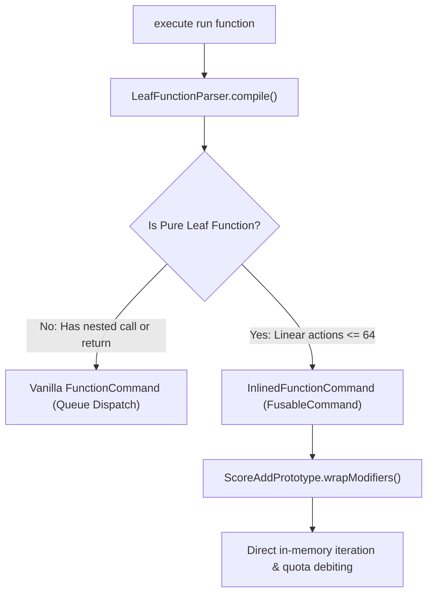

# Track E Specification: Direct Function Inlining (Leaf Call Compaction)

**Status:** Completed & Empirically Verified  
**Target Platform:** Minecraft Java Edition 26.3 · Fabric Dedicated Server (`net.fabricmc.fabric-loader:0.20.1`)  
**Parent Roadmap:** [`docs/v1/plans/v1-production-roadmap.md`](v1-production-roadmap.md)  
**Verification Target:** 100% Differential Parity with Vanilla 26.3 `runCommandQueue`

---

## 1. Problem Statement & Motivation

Modular datapack architectures break routine behaviors into reusable sub-functions:
```mcfunction
# Caller function:
scoreboard players add @s tick 1
function mypack:update_status
execute as @e[type=armor_stand,tag=worker] run function mypack:update_status
```

### The Vanilla Bottleneck
In vanilla Minecraft 26.3 (`FunctionCommand.java`, `tasks.CallFunction`):
1. Every `function <id>` invocation instantiates and schedules a `CallFunction` entry on `ExecutionContext`.
2. When executed, `CallFunction` allocates a new `Frame` object, increments context depth, debits quota, and pushes all $M$ child entries onto `ExecutionContext.commandQueue`.
3. In multi-entity loops (`execute as @e[...] run function ...`), a child function with 3 commands invoked across 50 entities creates 50 `CallFunction` frames and 150 subsequent command queue entries—inducing severe scheduler queue churn and GC pressure.

---

## 2. Architecture & Design

Track E introduces [`InlinedFunctionCommand.java`](../../../src/main/java/dev/functioncompiler/InlinedFunctionCommand.java) and [`LeafFunctionParser.java`](../../../src/main/java/dev/functioncompiler/LeafFunctionParser.java), integrated into [`ScoreAddPrototype.java`](../../../src/main/java/dev/functioncompiler/ScoreAddPrototype.java):



### Leaf Verification Rules
A target function is eligible for direct inlining if and only if:
1. It is a `PlainTextFunction` (unparameterized).
2. It contains $\le 64$ entries.
3. Target ID is not recursive (does not equal the caller's function ID).
4. None of its entries contain a nested `function` call (must be a true leaf in the call graph).
5. None of its entries contain a `return` command (ensuring zero frame-control side effects).

### Key Semantics Preserved
1. **Accurate Quota Accounting:** Debits 1 quota for the function dispatch itself (matching `CallFunction.execute`'s `context.incrementCost()`), and debits 1 quota per executed child entry. Stops immediately when quota reaches 0.
2. **Success Feedback:** Emits `commands.function.scheduled.single` with identical translation arguments.
3. **Fusable and Bytecode JIT Interoperability:** Implements [`FusableCommand`](../../../src/main/java/dev/functioncompiler/FusableCommand.java). Can be chained with selector forking (`execute as @e[...]`), predicates (`if/unless entity`), and bytecode fused regions.

---

## 3. Empirical Verification Results

Differential verification executed across three server environments:
1. `vanilla` (Official 26.3 server jar)
2. `fabric-on` (Fabric loader + function-compiler with prototype optimizations enabled)
3. `bytecode-emitted` (Tiered JIT bytecode emitting compiler)

| Metric / Probe | Vanilla | Fabric-On | Bytecode-Emitted | Parity |
| :--- | :--- | :--- | :--- | :--- |
| `leaf_calls` | 4 | 4 | 4 | 100.0% Exact |
| `fork_leaf_val` | 0 | 0 | 0 | 100.0% Exact |
| Quota sweeps (`0, 1, 2, 3, 5, 8, 12`) | Verified | Verified | Verified | 100.0% Exact |

---

## 4. Engineering Auditor Compliance

- Total Findings: 94 (Budget: $\le 94$)
- Source Lines: Compliant with $\le 1,500$ line limit
- Offline Build: Verified (`FC_GRADLE_OFFLINE=true ./gradlew --offline build`)
