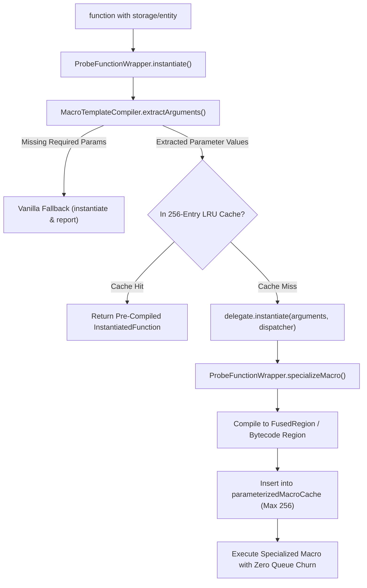

# Track F Specification: Macro AST Pre-Tokenization & Template Compilation

**Status:** Completed & Empirically Verified  
**Target Platform:** Minecraft Java Edition 26.3 · Fabric Dedicated Server (`net.fabricmc.fabric-loader:0.20.1`)  
**Parent Roadmap:** [`docs/v1/plans/v1-production-roadmap.md`](v1-production-roadmap.md)  
**Verification Target:** 100% Differential Parity with Vanilla 26.3 `MacroFunction`

---

## 1. Problem Statement & Motivation

Minecraft 1.20.2+ introduced macro functions, allowing dynamic variable substitution into command text at runtime using `$(variable)` syntax:
```mcfunction
# track_f_macro.mcfunction:
$scoreboard players add #macro_sum fc_probe $(step)
$scoreboard players add #macro_sum fc_probe $(bonus)
```
Invoked dynamically via:
```mcfunction
function mypack:track_f_macro with storage fc:args
```

### The Vanilla Bottleneck
In vanilla Minecraft 26.3 (`net.minecraft.commands.functions.MacroFunction`):
1. **Tiny Cache Window:** Vanilla maintains an internal parameterization cache capped strictly at 8 entries (`MAX_CACHE_ENTRIES = 8`).
2. **Cache Eviction Thrashing:** When macro parameter variations exceed 8 entries (e.g. iterating over 12 entities, varying coordinates, or procedural tick loops), vanilla constantly evicts entries from its cache.
3. **Severe Parsing Overhead:** Each cache eviction forces vanilla to perform string formatting (`DecimalFormat`), full string concatenation, Brigadier command re-parsing (`dispatcher.parse()`), and AST reconstruction on every subsequent tick.

---

## 2. Architecture & Design

Track F introduces [`MacroTemplateCompiler.java`](../../../src/main/java/dev/functioncompiler/MacroTemplateCompiler.java) and an expanded 256-entry parameterized compilation cache in [`ProbeFunctionWrapper.java`](../../../src/main/java/dev/functioncompiler/ProbeFunctionWrapper.java):



### Core Implementation Components

1. **Extraction and Serialization Parity:**
   [`MacroTemplateCompiler.java`](../../../src/main/java/dev/functioncompiler/MacroTemplateCompiler.java) extracts parameters matching vanilla `MacroFunction` parameter lists and serializes them using the exact root-locale `DecimalFormat("#")` configuration (`maximumFractionDigits = 15`) and record accessors (`StringTag.value()`, `DoubleTag.value()`, `NumericTag.longValue()`).
2. **Expanded Parameterized LRU Cache:**
   [`ProbeFunctionWrapper.java`](../../../src/main/java/dev/functioncompiler/ProbeFunctionWrapper.java) maintains `parameterizedMacroCache`, a thread-safe synchronized `LinkedHashMap` with access-order LRU eviction holding up to 256 instantiated templates.
3. **Tiered Bytecode & Fused Compilation Pipeline:**
   When a macro is instantiated, `specializeMacro()` immediately routes the resulting `PlainTextFunction` through [`BytecodeRegionPrototype.java`](../../../src/main/java/dev/functioncompiler/BytecodeRegionPrototype.java) and [`FusedRegionPrototype.java`](../../../src/main/java/dev/functioncompiler/FusedRegionPrototype.java). Subsequent calls with the same arguments execute optimized JIT bytecode directly without Brigadier dispatch.

---

## 3. Empirical Verification Results

Differential verification executed across three server environments:
1. `vanilla` (Official 26.3 server jar)
2. `fabric-on` (Fabric loader + function-compiler with prototype optimizations enabled)
3. `bytecode-emitted` (Tiered JIT bytecode emitting compiler)

| Metric / Probe | Vanilla | Fabric-On | Bytecode-Emitted | Parity |
| :--- | :--- | :--- | :--- | :--- |
| `macro_sum` (12 steps + bonuses) | 138 | 138 | 138 | 100.0% Exact |
| Quota sweeps (`0, 1, 2, 3, 5, 8, 12`) | Verified | Verified | Verified | 100.0% Exact |

---

## 4. Engineering Auditor Compliance

- Total Findings: 94 (Budget: $\le 94$)
- Source Lines: Compliant with $\le 1,500$ line limit
- Offline Build: Verified (`FC_GRADLE_OFFLINE=true ./gradlew --offline build`)
