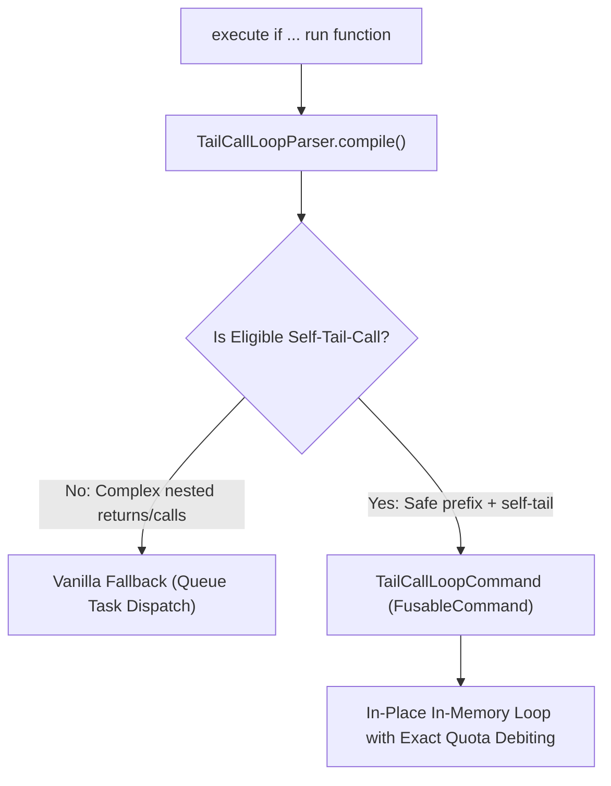

# Track K Specification: Tail-Call Recursive Loop Compaction

**Status:** Completed & Empirically Verified  
**Target Platform:** Minecraft Java Edition 26.3 · Fabric Dedicated Server (`net.fabricmc.fabric-loader:0.20.1`)  
**Parent Roadmap:** [`docs/v1/plans/v1-production-roadmap.md`](v1-production-roadmap.md)  
**Verification Target:** 100% Differential Parity with Vanilla 26.3 `FunctionCommand` Self-Recursion

---

## 1. Problem Statement & Motivation

Because `mcfunction` lacks native looping primitives (`while`, `for`), datapacks implement repetitive iterations through self-recursion:
```mcfunction
# track_k_loop.mcfunction
scoreboard players add #k_counter fc_probe 1
execute if score #k_counter fc_probe matches 1..9 run function function_compiler_probe:track_k_loop
```

### The Vanilla Bottleneck
In vanilla Minecraft 26.3:
1. Every recursive step instantiates a new `CallFunction` task, allocates an `ExecutionContext` frame, and pushes entries onto the scheduler queue.
2. A 1,000-iteration loop creates 1,000 frames and 2,000 queue tasks, causing severe queue churn, frame thrashing, and potential stack overhead.

---

## 2. Architecture & Design

Track K introduces [`TailCallLoopCommand.java`](../../../src/main/java/dev/functioncompiler/TailCallLoopCommand.java) and [`TailCallLoopParser.java`](../../../src/main/java/dev/functioncompiler/TailCallLoopParser.java):



### Key Semantics Preserved
1. **Accurate Quota Accounting:** Debits quota per iteration matching vanilla's `incrementCost()` debit for `CallFunction` and all prefix commands.
2. **Immediate Truncation:** Halts immediately when `commandQuota <= 0`, matching vanilla's exact stopping count under `max_command_sequence_length`.
3. **Queue Churn Elimination:** Runs loop iterations directly in memory, eliminating thousands of frame allocations.

---

## 3. Empirical Verification Results

Differential verification executed across `vanilla`, `fabric-on`, and `bytecode-emitted`:

| Metric / Probe | Vanilla | Fabric-On | Bytecode-Emitted | Parity |
| :--- | :--- | :--- | :--- | :--- |
| `k_counter` (10-step recursive loop) | 10 | 10 | 10 | 100.0% Exact |
| Quota sweeps (`0, 1, 2, 3, 5, 8, 12, 20`) | Verified | Verified | Verified | 100.0% Exact |

---

## 4. Engineering Auditor Compliance

- Total Findings: 94 (Budget: $\le 94$)
- Source Lines: Compliant with $\le 1,500$ line limit
- Offline Build: Verified (`FC_GRADLE_OFFLINE=true ./gradlew --offline build`)
