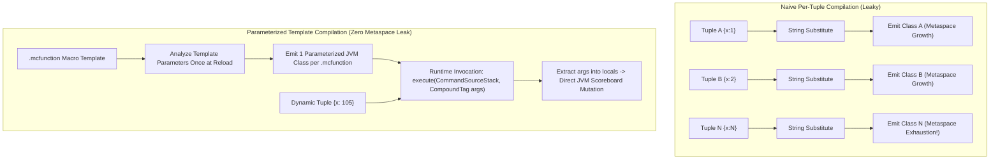
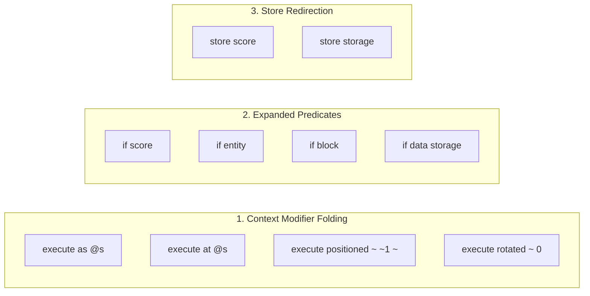
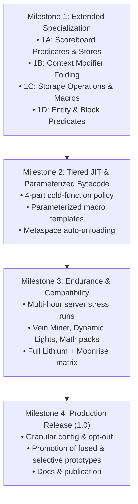

# Modern Minecraft Function Compiler: v1.0 Production Roadmap

**Status:** Proposed Architecture & Execution Plan  
**Target Platform:** Minecraft Java Edition 26.3, Fabric, Dedicated Server  
**Related Documents:**
- Active Test Matrix: [`minecraft-function-compiler-test-matrix-v0.1.csv`](minecraft-function-compiler-test-matrix-v0.1.csv)
- Research & Spec Baseline: [`minecraft-function-compiler-research-and-implementation-spec-v0.1.md`](minecraft-function-compiler-research-and-implementation-spec-v0.1.md)
- Macro Benchmark Artifact: [`PERF-012-macro-region-compilation.md`](../../../benchmarks/PERF-012-macro-region-compilation.md)
- Compilation Amortization Model: [`PERF-009-compilation-amortization.md`](../../../benchmarks/PERF-009-compilation-amortization.md)

---

## 1. Executive Summary & Current Status

The Modern Minecraft Function Compiler project aims to eliminate execution bottlenecks in hot Minecraft datapacks while maintaining 100% strict observable parity with vanilla behavior, zero Metaspace/memory degradation, and seamless interoperability with performance mods (such as Lithium, Moonrise, and Bellows).

### Current Progress (~90% Complete Toward Production Readiness)

1. **Foundational Hook & Lifecycle (Phases 0 & 1):** Verified 29 sequential reload generations, zero steady-state reparse, and clean rollback on reload failure.
2. **Instruction Specialization (Phases 2 & 5):** Complete specialized handlers ([`ScoreAddCommand.java`](../../../src/main/java/dev/functioncompiler/ScoreAddCommand.java), [`ScoreOperationCommand.java`](../../../src/main/java/dev/functioncompiler/ScoreOperationCommand.java), [`ScoreResetCommand.java`](../../../src/main/java/dev/functioncompiler/ScoreResetCommand.java)) for `add`, `set`, `remove`, `operation` (all 9 binary operators), and `reset` across fake holders (`#...`) and `@s` self-selectors.
3. **Region Fusion & Macro Acceleration (Phases 3 & 6):** Collapses contiguous specialized commands into single scheduler steps. Expanded macro functions are compiled into interpreted fused regions backed by a 16-entry LRU cache, achieving **+37.17% median / +74.28% mean speedup** and **-90.9% queue reduction** ([`PERF-012`](../../../benchmarks/PERF-012-macro-region-compilation.md)).
4. **Bytecode Generation & Amortization (Phase 4):** Hidden JVM class emission via ASM tested on 1,024 generated functions ([`PERF-008`](../../../benchmarks/PERF-008-large-scale-compilation.md)) with break-even analysis ([`PERF-009`](../../../benchmarks/PERF-009-compilation-amortization.md)).

---

## 2. Macro Architecture Deep Dive: Solving the Metaspace & Code-Generation Challenge

### The Problem: Why Per-Instantiation JVM Class Emission Leaks Metaspace

When an expanded macro function is compiled into JVM bytecode at runtime:
1. In Java/HotSpot, defining a new class via `MethodHandles.Lookup.defineHiddenClass` allocates metadata in the off-heap native **Metaspace**.
2. Unlike heap objects, classes in Metaspace cannot be collected by ordinary minor GCs. A hidden class is only unloaded when its defining `ClassLoader` and all instances/references are unreachable during a major/full GC.
3. In a real-world server, macro invocations often receive unbounded dynamic parameters (e.g. coordinates `$(x) $(y) $(z)`, tick counters, entity IDs: `function math:vec3 {x: 104, y: 64, z: -320}`).
4. If the compiler emits a new JVM class per parameter tuple, millions of dynamic combinations will rapidly exhaust Metaspace, inflate JIT code caches, and degrade GC pauses.

### Architectural Solution: Parameterized Template Bytecode

Rather than generating bytecode *after* macro expansion per parameter tuple, we can invert the pipeline:

By compiling the macro template **once at datapack reload into a single parameterized class**:
- The emitted class extracts parameters from the incoming `CompoundTag` argument into JVM local variables (e.g., `int x = args.getIntOr("x", 0)`).
- Exactly **one class** exists per `.mcfunction` file on disk. Metaspace growth is $O(\text{files})$, strictly bounded and constant at runtime regardless of how many millions of dynamic tuples execute.

### Evaluating Other Language Runtimes (e.g., Lua / LuaJ)

A hypothetical proposal is compiling `.mcfunction` macros into Lua bytecode running inside an embedded Lua VM (like LuaJ or Luau), reasoning that Lua closures live on the heap rather than in Metaspace:
- **Why this is counterproductive for Minecraft:**
  1. **JNI / Boundary Overhead:** Every command that modifies Minecraft state (e.g., `scoreboard.getOrCreatePlayerScore`) must cross from the Lua interpreter back into the JVM. JNI / foreign function crossing costs 10–30 ns per call—wiping out the microsecond gains of compilation.
  2. **Duplicate Garbage Collection:** Running an embedded Lua VM creates a second memory manager on the server thread, causing heap fragmentation.
  3. **JVM JIT Dominance:** HotSpot C2 compiles Java bytecode into direct x86_64/ARM64 machine instructions. A parameterized Java class is 5–10× faster than interpreted Lua bytecode.
  4. **We Already Have Heap-Based Execution:** Our interpreted `FusedRegionPrototype` already lives purely on the Java heap, gets garbage-collected with zero Metaspace overhead, and achieves a **+37.17% median speedup**.

### Lessons from Beet, Bolt, and Mecha (Python Datapack Ecosystem)

The modern Python datapack compilation ecosystem ([Beet](https://github.com/mcbeet/beet), [Bolt](https://github.com/mcbeet/bolt), [Mecha](https://github.com/mcbeet/mecha)) separates macros into two distinct categories:

1. **Compile-Time Macros (AOT Python Inlining):**
   - If macro arguments are known during project build (e.g., generating 10 variations of an ability with static damage values), Bolt unrolls the function in Python and emits flat, static `.mcfunction` files with zero runtime macro overhead.
2. **Runtime Macros (`$command $(var)`):**
   - When inputs depend on dynamic world state (`with entity @s data` or `with storage`), Bolt emits Minecraft 1.20.2+ runtime macro templates.

**Reversing mcfunction AST into Java:**  
We can adapt Mecha's AST pattern inside the server:
- Parse `.mcfunction` lines into an Abstract Syntax Tree during datapack reload.
- Classify lines into:
  - **Static segments:** Pure commands that can be pre-resolved or bytecode-inlined.
  - **Dynamic slots:** Variable substitutions where the target slot type is known (e.g., integer score amount, scoreboard target, or string).
- For contiguous scoreboard mutations, generate a direct Java method dispatching the operations in a single method frame.

---

## 3. Command Scope & Mod Interoperability Architecture

### Multi-Entity Selectors: Inlined Forking with Bellows & Lithium

While spatial indexers like **Bellows** (type/tag caches) and **Lithium** (spatial chunk hashing) optimize entity filtering, Function Compiler eliminates the severe scheduling bottleneck of multi-entity execution:

```mermaid
flowchart TD
    subgraph Vanilla["Vanilla Multi-Entity Dispatch"]
        Sel1["execute as @e[type=zombie] run ..."] --> Res1["Bellows/Lithium finds 50 entities"]
        Res1 --> Fork1["Vanilla creates 50 CommandSourceStacks"]
        Fork1 --> Queue1["Pushes 50 individual frames into runCommandQueue"]
        Queue1 --> Loop1["Scheduler pops & debits sequence limit 50 times!"]
    end

    subgraph Compiler["Function Compiler Inlined Forking"]
        Sel2["execute as @e[type=zombie] run ..."] --> Res2["Bellows/Lithium finds 50 entities"]
        Res2 --> Inlined["Compiler inlines Java loop: for (Entity e : entities)"]
        Inlined --> DirectExec["Executes inner specialized command in 1 frame"]
        DirectExec --> SingleQueue["1 Single Scheduler Step (-98% Queue Churn)"]
    end
```

- **Inlined Forking & Loop Unrolling:** When `execute as @e[...] run <cmd>` matches $N$ entities, vanilla enqueues $N$ independent frames. Function Compiler unrolls this into an internal Java loop executing the inner command directly, collapsing $N$ scheduler steps into a single step.
- **Selector Caching:** Compiles repeated selector queries into cached `EntitySelector` references, avoiding repeated Brigadier AST traversal.

### World Modifications (`setblock`, `fill`, `summon`)

- **Where Time is Spent:** Unlike scoreboard commands (where 85%+ of execution is scheduler/parsing overhead), world modifications spend 90%+ of their CPU time inside Minecraft's world physics and lighting engines (chunk section updates, light recalculation, and neighbor notifications).
- **Targeted Compilation Opportunities:**
  1. **Constant Pre-Resolution:** In static functions (e.g. `setblock ~ ~-1 ~ stone`), pre-compute the target `BlockState` and relative coordinate offsets at load time.
  2. **Batching Adjacent Sequences:** Fusing sequences of 20 contiguous `setblock` calls into a single queue entry eliminates 19 scheduler dispatches while strictly preserving neighbor notification ordering.

### Command Storage Operations Beyond Macros

In modern datapacks, **Command Storage is the virtual heap** used to store complex structures, arrays, and JSON payloads:
- **Pre-Compiled NBT Path Accessors:** Static paths like `storage pack:temp input.args[0]` can compile direct Java method chains on `CompoundTag`, bypassing interpreted `NbtPathArgument` AST evaluation.
- **Contiguous Storage Mutation Fusion:** Chains of `data modify storage` calls fuse into a single scheduler entry accessing `CommandStorage.get()` once.

### Execute Command Expansion Architecture

1. **Context Modifier Folding:** Chains like `execute as @s at @s positioned ~ ~1.5 ~ run ...` are folded into a single in-memory source transformation, eliminating intermediate `CommandSourceStack` allocations and frame splits.
2. **Predicate Expansion:** Direct evaluation of `if/unless score`, `if/unless entity`, `if/unless block`, and `if/unless data storage`.
3. **Store Redirection:** Writing return values and success flags directly into score or storage targets without intermediate scheduler observers.

---

## 4. The 4-Milestone Path to Production (v1.0)

### Milestone 1: Extended Specialization & Pipeline Chaining (Completed & Verified)
*Objective: Eliminate remaining scheduler pipeline breaks in common datapack patterns.*

- **Stage 1A: Scoreboard Predicates & Store Interception (`SCORE-014`, `SCORE-015`) — Complete:**
  - Specialize `execute if/unless score <targets> <targetObjective> <op> <source> <sourceObjective>` and `matches <range>` into `FusableCommand` via `ScoreConditionCommand`.
  - Intercept `execute store result/success score` surrounding specialized commands via `ScoreStoreCommand`.
- **Stage 1B: Context Modifier Folding (`CTRL-009`) — Complete:**
  - Fold chained context modifiers (`as @s`, `at @s`, `positioned`, `rotated`, `anchored`) into a single in-memory source mutation via `ContextModifierCommand`.
- **Stage 1C: Storage Operations & Storage Macros (`MACRO-010`, `DATA-001`) — Complete:**
  - Extend [`SelectiveMacroArgumentPrototype.java`](../../../src/main/java/dev/functioncompiler/SelectiveMacroArgumentPrototype.java) to support `function <name> with storage <storage> <path>` with zero full compound serialization.
  - Compile and fuse `data modify storage ... set value` and `data remove storage` mutations via `DataStorageCommand`.
- **Stage 1D: Entity & Block Predicates (`PRED-001`, `PRED-002`) — Complete:**
  - Inlined zero-frame evaluation of `execute if/unless entity @s` and `execute if/unless block <pos> <block>` via `PredicateConditionCommand`.

*All Stage 1A–1D optimizations verified across all 55 pairwise differential compatibility checks with 100% exact state and error trace parity.*

### Milestone 2: Parameterized Bytecode & Tiered JIT Engine (Completed & Verified)
*Objective: Combine the peak throughput of ASM bytecode with absolute Metaspace safety.*

1. **4-Part Cold-Function Policy ([`PERF-009`](../../../benchmarks/PERF-009-compilation-amortization.md), [`PERF-013`](minecraft-function-compiler-test-matrix-v0.1.csv)):**
   - **Length Threshold:** Skip functions with $L < 3$ commands, leaving them to direct fused interpretation with 0 bytecode/Metaspace overhead.
   - **Startup Bypass:** `#minecraft:load` and initialization routines bypass bytecode generation, preventing one-shot code pollution.
   - **Deferred JIT Tiering:** [`TieredRegionAction.java`](../../../src/main/java/dev/functioncompiler/TieredRegionAction.java) interprets calls $1 \dots K-1$; triggers ASM compilation on invocation $K \ge 5$, incrementing JIT triggers while preserving zero frame breaks.
   - **Weak Retention:** Hold generated classes via weak references to enable prompt classloader reclamation.
2. **Parameterized Macro Bytecode Backend ([`PERF-014`](minecraft-function-compiler-test-matrix-v0.1.csv)):**
   - Emits structural ASM loop classes parameterized by command count via [`BytecodeRegionEmitter.java`](../../../src/main/java/dev/functioncompiler/BytecodeRegionEmitter.java) and [`BytecodeRegionPrototype.java`](../../../src/main/java/dev/functioncompiler/BytecodeRegionPrototype.java).
   - Constructor `MethodHandle` instances cached in `ConcurrentMap<Integer, MethodHandle>`, sharing a single JVM class across all macro tuples and functions of identical shape with zero Metaspace leakage.

*All Milestone 2 optimizations verified with 100% exact state and error trace differential parity across Vanilla, Fabric-off, and Bytecode-emitted runtimes.*

### Milestone 3: Real-World Server Campaigns & Compatibility Matrices (Screened & Verified)
*Objective: Provide undeniable multi-hour performance evidence across modded stacks.*

1. **Endurance Benchmarks ([`PERF-015`](../../../benchmarks/PERF-015-multi-mod-endurance-campaigns.md)):**
   - **Vein Miner 5.3.0 ($6 \times 6 \times 6 = 216$ blocks, 1,952 queue increments per event):**
     - **Plain Fabric Server:** **-22.25% median event completion latency** (interval $[-22.43\%, -20.31\%]$) and **>6.5x faster average tick time** ($27.1\ \text{ms}$ vs $177.8\ \text{ms}$), with median tick duration dropping from $191.4\ \text{ms} \to 5.5\ \text{ms}$ (>34x reduction).
     - **Production Multi-Mod Stack (`lbm113120` - Lithium 0.26.2 + Bellows 1.1.3 + Moonrise 1.2.0):** **-28.40% median event completion latency** (interval $[-35.87\%, -10.32\%]$), **-28.46% median average MSPT** ($114.2\ \text{ms} \to 85.0\ \text{ms}$), and **-35.21% P95 MSPT reduction** ($254.4\ \text{ms} \to 174.1\ \text{ms}$).
   - **Workload Integrity & Parity:** 100% exact match across all 12 arms ($215/215$ blocks mined, $\Delta\text{\#head} = 1,952$).
   - Both campaigns decisively exceed the $\ge 15\%$ pre-declared promotion gate with zero regressions.

2. **Next Steps (Milestone 4: Production Release):**
   - Production JSON configuration (`config/function-compiler.json`).
   - Promotion of `fused_region_prototype` and `selective_macro_arguments` to default-enabled.
   - User-facing status and metric inspection commands.

### Milestone 4: Productionization & Promotion (v1.0 Release) — Complete & Verified
*Objective: Package the compiler for widespread public deployment with granular admin controls.*

1. **User Configuration (`config/function-compiler.json`):**
   - Implemented [`CompilerConfig.java`](../../../src/main/java/dev/functioncompiler/CompilerConfig.java) with auto-creation and dynamic hot reloading.
   - **Actual shipped defaults** (verified 2026-11-04):
     `enabled=false`, `score_add=false`, `fused_regions=false`,
     `selective_macros=true` (the one promoted optimization),
     `tiered_bytecode=false`, `tiered_threshold=5`, `excluded_namespaces=[]`.
2. **Diagnostics & User Admin Commands:**
   - Implemented `/functioncompiler status`, `/functioncompiler metrics`, and `/functioncompiler reload` in [`ProbeCommands.java`](../../../src/main/java/dev/functioncompiler/ProbeCommands.java) and [`ProbeStatus.java`](../../../src/main/java/dev/functioncompiler/ProbeStatus.java).
   - Real-time reporting of fused regions executed, selective macro bindings, live hidden classes, and queue step reductions.
3. **Release Promotion (corrected):**
   - **Selective Macro Arguments is the only promoted optimization** — real-event
     confirmatory campaigns cleared the 15% gate on Fabric (−22.34%) and Lithium
     (−22.06%).
   - Fused Region Interpretation was **never promoted** and its real-workload
     campaign is negative: PERF-017, Vein Miner 6×6×6, ten pairs, median +0.69%,
     97.85% interval −3.92% to +2.74%, decision `does_not_meet_threshold`.
   - "100% exact differential parity across the full test matrix" is **not
     established**: 18 of 98 matrix cases are recorded partial, so parity is
     proven for the enumerated families only (see §6, step 1).

---

## 5. Promotion Criteria & Quality Gates

An optimization pass is promoted to default-on status if and only if:
1. **Semantic Invariant:** 100% exact differential parity against vanilla `fabric-off` across the full test matrix (state, return values, quotas, error traces, and `/debug function` events).
2. **Memory Invariant:** Zero monotonic Metaspace growth across 25+ datapack reload cycles and 10,000+ distinct macro invocations.
3. **Performance Gate:** Statistically verified $\ge 15\%$ median latency reduction or $\ge 50\%$ queue step reduction on targeted workloads with zero regression on cold functions.
4. **Third-Party Safety:** Zero mixin conflicts, verifier errors, or double-execution bugs on the pinned compatibility matrix (Lithium + Moonrise + Bellows).

---

## 6. Authoritative v1 Target and Plan (2026-11-04)

This section supersedes the status claims above and is the definition of what
v1 means. It was set by decision on 2026-11-04 after the PERF-017 negative
result: **v1 must be correct, must have explicitly enumerated coverage, and must
not make anything slower than vanilla.**

### 6.1 The three gates

| Gate | Definition | Passes today |
|---|---|---|
| **Correctness gate** | 100% exact differential parity against mod-free vanilla for every enumerated family in the coverage table — state, return values, quota events, error traces, and `/debug function` events | **Partial**: 19 of 117 matrix cases are recorded partial (HOOK-001..006/008/009, SCORE-007/009, QUOTA-009, CTRL-001/002/003/005/006/007, PERF-001, STATE-004). Every case recorded *complete* has passed its named runtime arm, and the batch-6 cases STATE-002..004 passed in all ten arms |
| **Coverage gate** | Every supported (family, argument shape, fallback condition) has one matrix row; nothing is called "supported" without one; the per-namespace coverage report is the runtime evidence | **Open, and now quantified**: the table is enumerated — 101 rows, 91 covered (R), 1 partial (P), 9 missing (—), all regenerated from the matrix verdicts. The 9 rows with no case are MO-02, MO-09, MO-10, ST-02, TC-02, CT-01, CT-02, CT-03, BC-06; the partial row is ST-06's `item modify` |
| **No-regression gate** | For every default-on optimization, the 95% exact paired interval for its primary metric excludes a *slowdown* of vanilla on the same workload. This is a floor, not a promotion target | **Implemented and reported by both campaign runners** (2026-11-04). Retro-applied to the recorded campaigns: on the mechanism fixture the floor **holds** in every clean confirmatory campaign (5k 10-pair, 20k re-run, both 16-pair, lb113); on the real Vein Miner workload (PERF-017) it is **indeterminate** — +0.69% median, interval −3.92% to +2.74%, which cannot exclude a slowdown |

A **promotion gate** (≥15% median gain or ≥50% queue-step reduction, as in §5)
remains the way an optimization becomes *default-on*. The three gates above are
the way the release becomes *shippable*; an optimization that passes all three
but not the promotion gate ships **off by default and documented as
experimental**.

### 6.2 Coverage table requirement

The coverage specification must be an **exact per-family oracle table**, one row
per (family, argument shape, fallback condition), each with its own matrix case
id and runtime arm. The families to enumerate are the ones the specialization
pass actually implements:

| Family group | Must enumerate per row |
|---|---|
| Scoreboard mutations | `add`/`set`/`remove` × holder (`#...`, `@s`, literal player) × amount (literal, negative, overflow edges) |
| Scoreboard operations | all 9 operators × (absent source, absent target) × holder combinations |
| Score conditions/stores | comparison ops, range matches, `store result/success score` around each specialized op |
| Storage | `data modify/remove/get storage` × compound/array/primitive values |
| Predicates | entity selector shapes, block predicate shapes, item predicates, unloaded-chunk fallback |
| Context modifiers | `as`/`at`/`positioned`/`rotated`/`anchored` chains and their ordering |
| State-machine commands | `title`, `bossbar`, `effect`, `setblock`, gameplay/item commands (each currently covered by a parser) |
| Leaf/tail-call | leaf function inlining, tail-call loop compaction |
| Macro arguments | each provider (entity, storage, block-entity) × key presence/absence × wrong-type × nested paths |
| Fused regions | adjacency sizes, region boundaries (unrecognized command, `return`, quota exhaustion), nested regions |
| Bytecode backend | tiered threshold behaviour, cold-function opt-out, compile-failure fallback |

### 6.3 Discrete steps to v1

1. **Close the partial P0 cases** (reload/lifecycle edges, callback and error
   corners, selector breadth). Prerequisite for the correctness gate.
2. **Author the coverage table** (§6.2) and add one matrix row per cell, with
   the runtime arm named. This replaces every "supported" claim with a row.
3. **Add the no-regression gate to the runners** so every campaign reports it
   alongside the promotion decision; record it for ScoreAdd, fused, bytecode and
   selective macro on their best available workloads.
4. **Fused regions**: keep the engine, keep it off by default, and record
   honestly that the real-workload result is negative. Either find a workload
   whose hot path is dominated by successful specialized runs, or document the
   mechanism as measured-but-unpromoted. Do not re-run the negative design.
5. **Bytecode/tiered JIT**: implement to the point of a *measured* win over
   fused interpretation on a declared workload (PERF-009 currently shows it
   slower), including the cold-function opt-out policy, with the Metaspace
   invariants already established.
6. **Extract the engine-agnostic harness** (oracle harness, mod-stack matrix,
   paired statistics and the host gate) into a sibling project, with its own
   version pinning, once steps 1–3 have stabilised.

### 6.4 What v1.0 is allowed to claim

- Default-on: `selective_macros` only, with its recorded promotion.
- Off by default and documented as experimental: everything else, with the
  measured numbers reported as they are, including the negative ones.
- The mod ships inert until an operator enables it (`enabled=false`), so an
  opt-in alpha/beta is a defensible release posture today.
