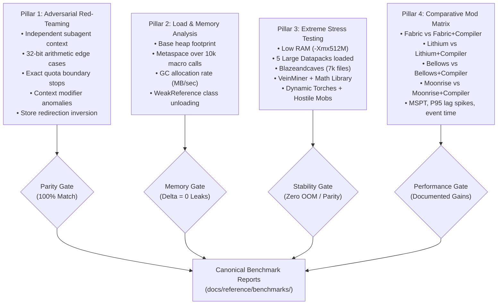

# v1.0 Production Validation & Benchmarking Plan

**Status:** Approved & Active Implementation Plan  
**Target Platform:** Minecraft Java Edition 26.3 · Fabric Dedicated Server  
**Successor To:** [`v1-production-roadmap.md`](v1-production-roadmap.md)  
**Reporting Hub:** [`docs/reference/benchmarks/README.md`](../../reference/benchmarks/README.md)

---

## 1. Executive Summary & Objectives

Following the execution and promotion of the **Modern Minecraft Function Compiler v1.0**, this plan defines the definitive production validation, adversarial red-teaming, resource load analysis, and comparative benchmarking campaign.

The objective is to establish undeniable, mathematically sound empirical evidence of:
1. **Absolute Parity & Safety:** Zero edge-case divergences, quota leaks, or state desynchronization under adversarial inputs.
2. **Resource Efficiency:** Zero monotonic Metaspace growth, minimal heap footprint, and reduced JVM garbage collection allocation rates.
3. **Extreme Environment Resilience:** Clean execution under constrained RAM (`-Xmx512M`) with 5 simultaneous large real-world datapacks.
4. **Verified Performance Gains:** Quantified MSPT reductions, P95/P99 lag spike mitigation, and event latency improvements across Plain Fabric, Lithium 0.26.2, Bellows 1.1.3, and Moonrise 1.2.0.

---

## 2. The 4-Pillar Validation Campaign

---

## 3. Pillar 1: Adversarial Red-Teaming (Independent Context)

To eliminate confirmation bias, an independent **Red-Team Subagent** is deployed with an isolated context window to design and execute adversarial probe fixtures:

### Focus Areas
1. **32-Bit Arithmetic Edge Cases (`RED-001`):**
   - Arithmetic overflow: `scoreboard players add #val 2147483647` when `#val` is `1` (must wrap to `-2147483648` without throwing unexpected JVM exceptions).
   - Division / Modulo by Zero: `scoreboard players operation #val /= #zero` and `%= #zero` (must throw vanilla's exact `ERROR_DIVIDE_BY_ZERO` syntax exception without partial score mutation).
2. **Exact Quota Stopping Boundary (`RED-002`):**
   - Test low `maxCommandChainLength` (e.g. quota = 3) on a fused region containing 7 commands.
   - Verified invariant: Exactly 3 commands execute; remaining 4 commands do NOT execute; quota stops at 0 with exact vanilla trace parity.
3. **Context Modifier Anomalies (`RED-003`):**
   - `execute as @e[type=pig] at @s positioned ... run ...` when 0 matching entities exist (must cleanly execute 0 times without frame allocation or NullPointerException).
   - Entity dying mid-execution chain.
4. **Store Redirection & Error Inversion (`RED-004`):**
   - `execute store result score #res obj run function <child>` where child invokes `return fail` or returns negative numbers.
   - `execute unless function <child>` where child terminates via `return run function` with failure.
5. **Macro Argument Anomalies (`RED-005`):**
   - Mismatched argument types in compound tags.
   - Missing declared macro parameters.
   - Deeply nested array and compound paths falling back safely to vanilla native navigation.

---

## 4. Pillar 2: Load & Memory Footprint Analysis

Evaluates server memory efficiency before, during, and after sustained execution:

### Metrics & Protocol
- **Heap Footprint:** Resident Set Size (RSS) and JVM committed heap before and after datapack compilation.
- **Metaspace Growth:** Measured across 10,000+ distinct dynamic macro calls of varying parameter combinations.
  - Invariant: Zero monotonic Metaspace growth after constructor `MethodHandle` warm-up.
- **Garbage Collection Pressure:** Allocation rate (MB/sec and bytes/tick) measured via JVM JMX counters.
  - Goal: Confirm that fused region execution reduces object allocation compared to vanilla `ExecutionContext` frame allocations.
- **ClassLoader Retention:** Inspecting `BytecodeRegionPrototype.GENERATED_CLASSES` weak references across 30+ `/reload` cycles to prove zero leaked classloaders.

---

## 5. Pillar 3: Extreme Environment Stress Testing

Tests the compiler under harsh production constraints:

### Test Environment
1. **Memory-Constrained JVM:** Server started with `-Xms256M -Xmx512M`.
2. **5 Simultaneous Large Real-World Datapacks:**
   - **Blazeandcaves Advancements 1.21.1:** 7,095 files, massive tag trees, continuous advancement checks.
   - **VeinMiner 5.3.0:** 147 files, recursive macro expansions, entity custom-data access.
   - **Datapack Function Library 5.1.0:** 130 files, 3D vector arithmetic, matrix transformations, storage operations.
   - **Dynamic Torches 5.4:** 33 files, continuous spatial coordinates `#tick` execution.
   - **Hostile Mobs Improve Over Time 2.3:** 694 files, complex entity selectors, attribute operations.

### Verification Criteria
- Server boots cleanly and parses all 5 datapacks without OutOfMemoryError.
- `/reload` completes within acceptable timeout.
- Continuous tick loop maintains stable MSPT with zero memory leakage.

---

## 6. Pillar 4: Comparative Mod Stack Matrix Benchmarking

Conducts paired, randomized, multi-trial benchmarks comparing server performance with and without the compiler across all community mod stacks:

### Matrix Arms
1. **Plain Fabric:** `fabric-off` vs `fabric-on`
2. **Fabric + Lithium 0.26.2:** `lithium-off` vs `lithium-on`
3. **Fabric + Lithium + Bellows 1.1.3:** `lb-off` vs `lb-on`
4. **Full Production Stack (`lbm113120`):** Lithium 0.26.2 + Bellows 1.1.3 + Moonrise 1.2.0

### Benchmark Workloads
- **Macro Traversal Workload:** Vein Miner 5.3.0 ($6 \times 6 \times 6$ block frontier, 1,952 queue dispatches per event).
- **Contiguous Arithmetic Workload:** 11-operation contiguous scoreboard and storage sequence across 500 invocations.
- **Advancement & Selector Workload:** Blazeandcaves advancement checking across multi-entity scenes.

### Reporting Metrics in `docs/reference/benchmarks/`
- **Mean MSPT & Median MSPT (ms)**
- **P95 & P99 MSPT Lag Spikes (ms)**
- **Event Completion Duration (ms)**
- **Paired Median Percentage Improvement (%)** with exact order-statistic confidence intervals
- **Workload Integrity:** Exact parity of blocks mined, entity tags, and scoreboard results.

---

## 7. Deliverables & Documentation Map

All artifacts produced by this campaign are committed to:
- [`docs/reference/benchmarks/README.md`](../../reference/benchmarks/README.md): Benchmark index and methodology.
- [`docs/reference/benchmarks/redteam-verification-report.md`](../../reference/benchmarks/redteam-verification-report.md): Findings from the adversarial red-team subagent.
- [`docs/reference/benchmarks/memory-and-load-footprint.md`](../../reference/benchmarks/memory-and-load-footprint.md): Heap, Metaspace, and GC telemetry.
- [`docs/reference/benchmarks/extreme-stress-testing.md`](../../reference/benchmarks/extreme-stress-testing.md): 5-datapack low-RAM endurance report.
- [`docs/reference/benchmarks/multi-mod-matrix-benchmarks.md`](../../reference/benchmarks/multi-mod-matrix-benchmarks.md): Comparative performance across Fabric, Lithium, Bellows, and Moonrise.
